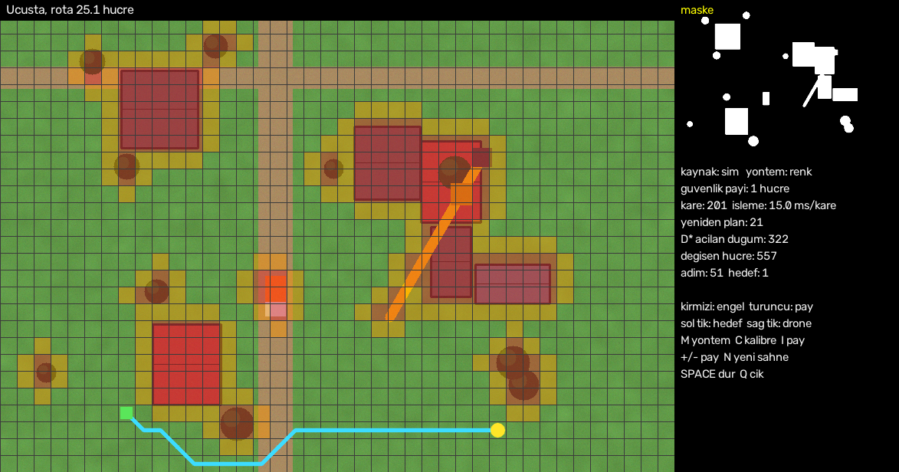
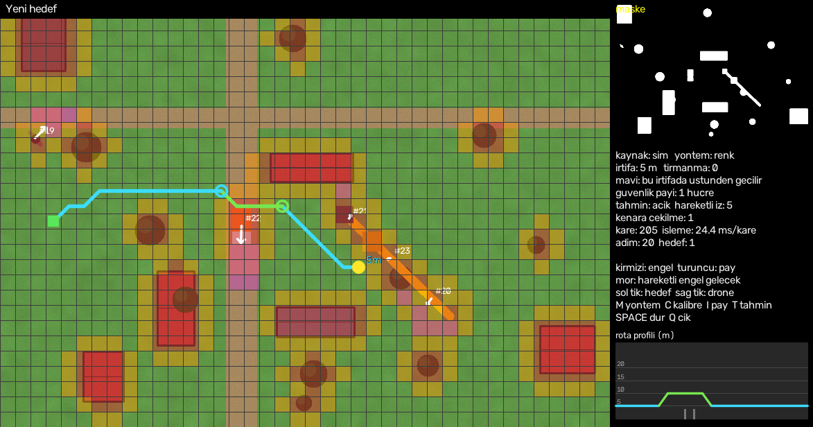
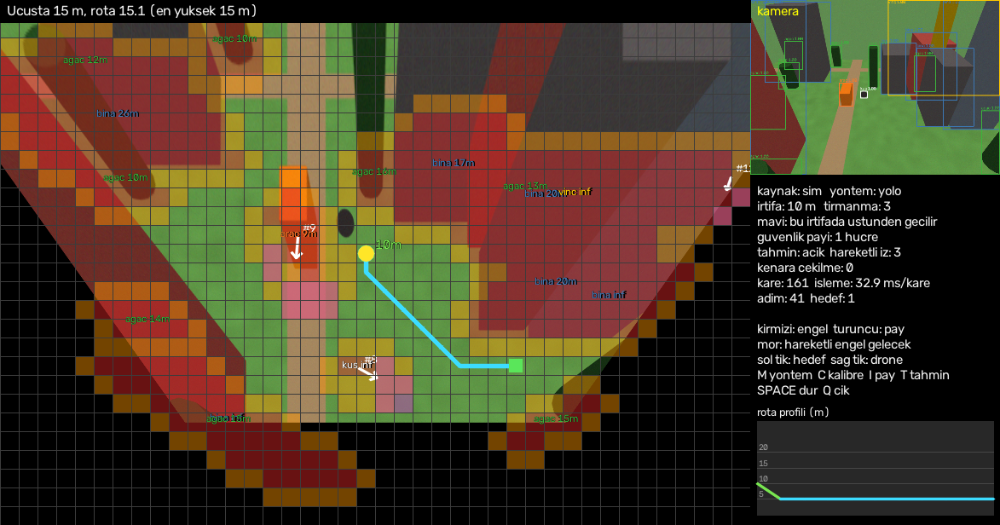
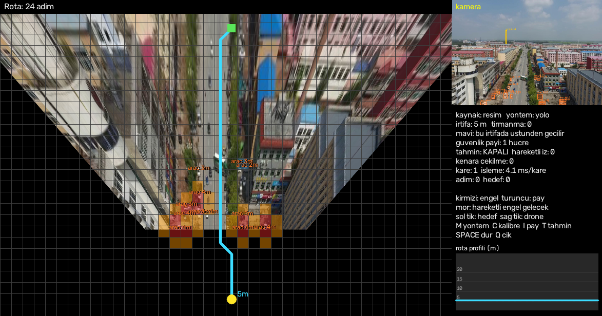
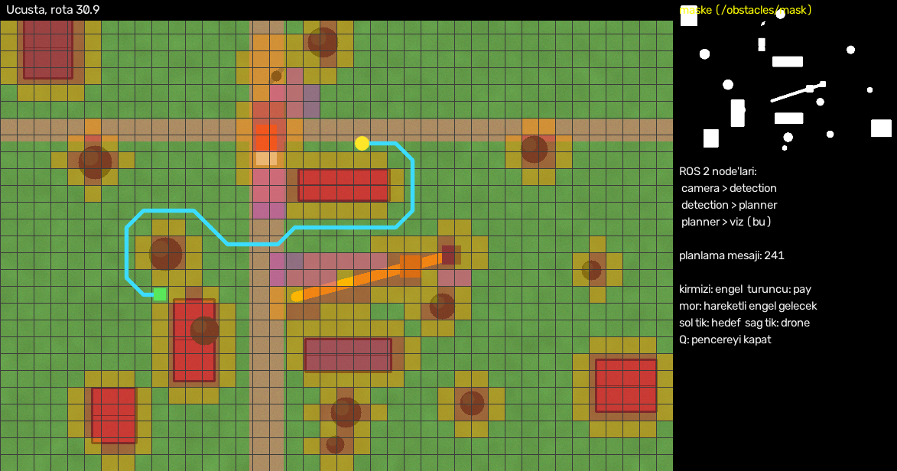
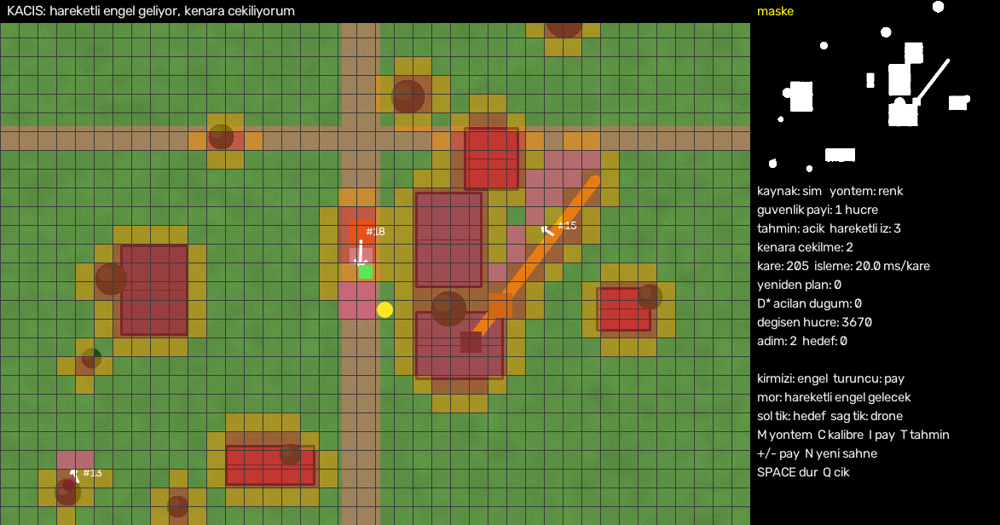

# DroneRoute Agent

IEEE İSTÜN CS Komitesi 2026-27 · RAS ortak proje. Kamera verisinden engel algılayıp anlık güvenli rota hesaplayan drone / kara aracı ajanı.

## Kurulum

```bash
pip install -r requirements.txt
pip install -r requirements-yolo.txt     # sadece YOLO (Adım 5) için: ultralytics + PyTorch (CPU), ~1 GB
```

## Çalıştır

**Sunum için tek komut:** ekran dörde bölünür, her çeyrekte bir adım (D* Lite, kamera + takip, 3D irtifa,
YOLO + eğik kamera) kendi kendine uçar ve kendi testini canlı yapar (çarpma sayısı, D* = A* kontrolü).
Her çeyreğin altında o an ne olduğunu anlatan Türkçe yazı var.

```bash
python demo_sahne.py                     # izle (F: tam ekran, SPACE: dur, Q: çık)
python demo_sahne.py --kaydet demo4.mp4  # pencere açmadan 1920x1080 video üretir (ekran kaydı gerekmez)
```

Hazır kaydı `docs/demo4.mp4`'te. Hedef bir engelin içine düşerse drone beklemek yerine hedefe en yakın boş noktaya gider.

```bash
python drone_vision.py                 # Adım 2 + 2.5: engel algıla, hareketlileri takip et, D* Lite ile kaç
python drone_vision.py --3d            # Adım 4: aynısı irtifalı (3D D* Lite), alçak engellerin üstünden geçer
python drone_vision.py --tahminsiz     # karşılaştırma: tahmin kapalı (kamyon drone'u ezebiliyor)
python drone_vision.py --kamera        # webcam ile (açılmazsa simülasyona düşer)
python drone_vision.py --video x.mp4   # kayıtlı video ile
python drone_dstar_lite.py             # Adım 1: elle duvar çizilen D* Lite demosu
python drone_vision.py --yontem yolo --perspektif --model sim --3d   # Adım 5: eğik kameralı sahne (model indirmez)
python drone_yolo.py --resim foto.jpg --perspektif --irtifa 40 --egim 30   # Adım 5: gerçek fotoğrafta YOLO
```

ROS 2 ile çalıştırmak için aşağıdaki "ROS 2 (Adım 3)" bölümüne bak.

### drone_vision.py



Kuşbakışı kare → engel maskesi → 40x28 grid → zaman filtresi → güvenlik payı → D* Lite. Her karede sadece değişen hücreler D* Lite'a verilir, rota artımlı güncellenir.

- **renk** yöntemi (varsayılan): boş zeminin H-S-V histogramı öğrenilir, zemine benzemeyen her şey engel. Webcam'de önce boş zemini (masa, yer) göster, `C`'ye bas, sonra nesneleri koy.
- **kenar** yöntemi: Canny + kontur doldurma, kalibrasyon istemez ama dokulu zeminde gürültülü.
- **Zaman filtresi:** hücre 2 kare üst üste dolu görülünce dolu, 4 kare boş görülünce boş olur. Tek karelik titreme yeniden planlatmaz.
- **Güvenlik payı:** engeller 1 hücre (dairesel) şişirilir, drone vinç/ağaç dibinden geçmez. Kırmızı engel, turuncu pay.

### Hareketli engeller (drone_tracker.py)

Kamyon, dönen vinç kolu ve kuş artık takip ediliyor. Drone sadece şu anki engellere değil, engelin birkaç kare sonra nerede olacağına göre rota kuruyor; rotası kapanırsa olduğu yerde ezilmeyi beklemiyor, kenara çekiliyor.

- **Sabit harita:** 60 kare boyunca hep dolu kalan pikseller sabit (bina, ağaç, vinç kulesi). Takip sadece geri kalan hareketli maskede çalışır, böylece vinç kolu binanın üstünden geçerken ikisi tek leke olup takibi bozmaz.
- **Takip:** hareketli lekelerin ağırlık merkezi, alanı ve yönelimi (ikinci momentler) hesaplanır, önceki izin tahmini merkezine en yakın leke eşleşir. Her iz rijit cisim gibi: merkez hızı `v` + açısal hız `w`. Kamyon için `w ≈ 0`, vinç kolu için dönme hızı çıkar. Leke birleşir/bölünürse hız güncellenmez, bölünen parça ana izin hareketini miras alır.
- **Tahmin:** her izin noktaları `p(h) = c + v·h + R(w·h)(p − c)` ile 20 kare ileri taşınır, her hücre için "engel kaç kare sonra burada" (tti) çıkar. Güvenlik payı bu haritaya da uygulanır.
- **D* Lite'a giriş:** 8 kare içinde gelecek hücreler duvar, 8-20 kare arası gelecekler pahalı hücre (en fazla 5 kat). Bunun için D* Lite ve A*'a isteğe bağlı hücre cezası eklendi (`penalty`), ceza ≥ 0 olduğu için ikisi de hâlâ optimal.
- **Kenara çekilme:** rota yok ve drone'un hücresine bir şey geliyorsa, komşu 8 hücreden engelin en geç geleceği yere geçer.
- **Kör nokta:** kadrajın dışını göremiyoruz, kamyon kenardan aniden girebilir. Kenardaki 2 hücrelik şerit pahalı, rastgele hedef oraya konmaz. Kenarda yeni beliren ve hızı bilinmeyen cisim, onaylanana kadar her yöne 3.5 piksel/kare ile gelebilir varsayılır.

Ekranda: mor hücreler engelin yakında geleceği yerler (koyu = daha yakında), beyaz oklar izlerin 10 karelik hızı.

Kontroller: sol tık hedef, sağ tık drone, M yöntem, C kalibrasyon, I pay aç/kapat, +/- pay, T tahmin aç/kapat, SPACE duraklat, N yeni sahne, Q çık.

Pencere açmadan dene: `python drone_vision.py --headless 600 --seed 1` (istatistik basar, PNG kaydeder).

drone_dstar_lite.py kontrolleri: sol tık duvar ekle, sağ tık duvar sil, G hedefi taşı, SPACE duraklat, E rastgele engel aç/kapat, R yeni harita.

### İrtifa: 3D D* Lite (drone_dstar3d.py, drone_plan3d.py)



Drone artık 4 irtifa katmanında uçuyor: 5, 10, 15, 20 m. Düğüm `(x, y, z)`; aynı katmanda 8 yöne, ya da bir katman yukarı/aşağı gidiyor.

- **Engel boyu:** simülasyonda her engelin boyu var (kamyon 4 m, ağaç 6-14 m, bina 8-28 m, kuş 12 m, vinç kolu 35 m, kulesi 45 m). Kamera yanında bir "derinlik" görüntüsü veriyor (piksel başına zeminden yükseklik); gerçek drone'da bu bir derinlik kamerası olur. Hücrenin boyu içindeki engel piksellerinin en yükseği.
- **Katman kapanır mı:** `irtifa < engel boyu + 2 m`. 5 m'deki drone 4 m'lik kamyona çarpar, 10 m'deki üstünden geçer. Vinç kolu (35 m) hiçbir katmandan geçilmez.
- **Hareketli engeller:** takipçi her izin boyunu da biliyor; "kamyon 6 kare sonra burada" tahmini sadece kamyonun kapattığı katmanlarda duvar/ceza oluyor. Rotası kapanan drone artık yana kaçmak yerine yükselebiliyor ve kamyon geçince aynı noktaya geri alçalıyor.
- **Maliyet:** yatay hücre 1 (çapraz √2), bir katman tırmanma 3, alçalma 2, ve her katman yatay hareketi %5 pahalılaştırıyor. Yani drone gerekmedikçe alçakta kalıyor; engelin etrafından dolaşmak üstünden aşmaktan pahalıysa tırmanıyor. (`drone_dstar3d.py` başındaki sabitler.)
- **D* Lite aynı algoritma:** `DStarLite3D` 2D sınıfı miras alıyor, sadece komşuluk (10 komşu) ve yönlü maliyet farklı. Sezgisel `octile + |dz| * 2` her kenardan küçük, yani hâlâ optimal; test her karede 3D A* ile aynı maliyeti bulduğunu kontrol ediyor.
- **Derinlik yoksa** (webcam): her engel sonsuz yüksek sayılıyor, drone hiç tırmanmıyor, 2D gibi davranıyor.

Ekranda: rota rengi irtifa (mavi 5, yeşil 10, turuncu 15, pembe 20 m), halka tırmanma/alçalma noktası, drone'un yanında irtifası, mavi hücreler o irtifada üstünden geçilen engeller, sağ altta rota profili (gri çubuk altındaki engelin boyu).

### YOLO + eğik kamera (Adım 5: drone_yolo.py)



Renk/kenar algılama "zemine benzemeyen her şey engel" diyordu, ne olduğunu bilmiyordu. Şimdi önceden eğitilmiş bir YOLO modeli engelin **sınıfını** söylüyor: `vinc`, `bina`, `agac`, `arac`, `insan`, `kus`. Rota hesaplama hâlâ tamamen bizim D* Lite'ımız; YOLO sadece "ne nerede" diyor.

**Model: YOLOE-26s (açık sözlük).** COCO'da vinç ve bina sınıfı yok. Açık sözlük modele sınıfları İngilizce yazıyla veriyoruz (`"tower crane"`, `"building"`, `"truck"`...), yeniden eğitmeden tanıyor. Sözlük bir kere modele gömülüp `models/droneroute_yoloe.pt` olarak kaydediliyor:

```bash
pip install -r requirements-yolo.txt
python drone_yolo.py --model-hazirla      # bir kerelik ~300 MB indirme (model + metin kodlayıcı), sonra internet gerekmez
```

CPU'da kare başına ~0.25 sn, GPU şart değil. Dürüst durum: **araç, insan ve vinçte iyi; bina ve ağacı (özellikle yukarıdan) çoğu zaman kaçırıyor** (VisDrone drone fotoğraflarında denedim: yüzlerce araç/insan, vinç buldu, bina neredeyse hiç). O yüzden:

- **`--yontem hibrit`** (kuşbakışı): YOLO'nun bulduklarına sınıf + boy, kaçırdıklarını renk yöntemi yakalıyor (boyu bilinmiyor = üstünden uçulmaz). Kuşbakışı için önerdiğim mod bu.
- Asıl çözüm küçük bir **ince ayar** (fine-tune, ör. drone görüntülü bir bina/ağaç veri setiyle). `--model kendi.pt` ile verirsin; sınıf adları `drone_yolo.py` içindeki sözlükle eşleşiyorsa (ya da `vinc/bina/...` diye adlandırırsan) direkt çalışır. COCO modelleri de çalışıyor (`--model yolo11n.pt`: araç, insan, kuş).

**Sınıf → boy (3D planlama için):** derinlik kamerası yoksa boy sınıftan geliyor: araç 4.5 m, ağaç 15 m, bina 30 m. İnsan, kuş ve vinç **sonsuz**: kural gereği üstlerinden uçulmuyor. Derinlik varsa (sim) ölçülen boy kullanılıyor.

**Eğik kamera (`--perspektif`).** Gerçek drone kamerası yere dik bakmaz, öne eğik bakar; piksel artık zemindeki bir hücre değil. `GroundProjector`:

- **Zemin homografisi:** görüntü pikseli ↔ zemin (metre), 3x3. Kameranın irtifa/eğim/görüş açısından hesaplanıyor ya da sahada 4+ bilinen noktadan kalibre ediliyor (`--kalibrasyon nokta.json`: `{"goruntu": [[u,v],...], "zemin": [[X,Y],...]}`). Homografi DLT ile, kendi kodumuz.
- **Yerdeki engel:** kutunun alt kenarı zemine değiyor; homografiyle zemine indirince engelin önü ve uzaklığı çıkıyor. Arkaya ne kadar uzandığını göremiyoruz, sınıftan tahmin (bina 12 m, araç 7 m).
- **Boy (derinlik tahmini):** kutunun tepesinden geçen ışın, engelin uzaklığında ne kadar yüksekte? Yukarıdan bakınca kutunun tepesi aslında çatının arka kenarı, yani boy biraz **fazla** çıkıyor (güvenli taraf, testte hiç az çıkmadı).
- **Uçan (kuş/drone):** yere değmiyor; gerçek boyutu ~1 m varsayılıp `uzaklık = odak × boyut / piksel genişliği`.
- **Kadrajdan kesik kutu:** altı kesikse engelin ayağı kameraya daha yakın, taban öne doğru uzatılıyor; tepesi kesikse boy bilinmiyor = sonsuz.
- **Görmediğin yer:** kameranın görüş alanı dışındaki hücreler kenar şeridi gibi pahalı; drone oraya gerekmedikçe girmiyor, rastgele hedef de oraya konmuyor.

Grid yine 40x28 ama eğik kamerada bir hücre `--hucre-m` metre (varsayılan 2 m → 80 m x 56 m), kamera grid'in alt ortasında, ileri = yukarı. Ana pencere kameranın görüntüsünü yere serilmiş (kuşbakışı) gösteriyor, sağ üstte tespitli kamera karesi. Uzun engeller yere serilince "yatmış" görünür, bu düz zemin varsayımının doğal sonucu; grid'deki engel hücreleri ise tespitlerden, onlar doğru yerde.

Sınırlar: kamera sabit varsayılıyor (gözcü). Kamera drone'la birlikte hareket edince her karede drone'un konumu (odometri) lazım, bu Gazebo/PX4 adımıyla geliyor. Görüş alanının dışı ve büyük engellerin arkası bilinmiyor.

```bash
python drone_vision.py --yontem yolo --model sim                       # kuşbakışı sim, "kusursuz YOLO" (sahne kutuları)
python drone_vision.py --yontem yolo --model sim --perspektif --3d     # eğik kameralı sim (25 m, 35° eğik)
python drone_vision.py --yontem hibrit --kamera                        # webcam, gerçek YOLO + renk
python drone_vision.py --yontem yolo --video ucus.mp4 --perspektif --irtifa 40 --egim 30 --vfov 52
python drone_yolo.py --resim foto.jpg --perspektif --irtifa 40 --egim 7 --vfov 52 --hucre-m 8 --3d
```

`drone_yolo.py` penceresinde drone rota boyunca uçar: **sol tık hedef, sağ tık drone, SPACE dur/devam, R baştan, Q çık** (fotoğrafta tespit bir kere yapılır, videoda her karede). Hazır örnek fotoğraflar `ornekler/` klasöründe.

`--model sim`, simülasyon sahnesinin nesnelerini kutu olarak veren sahte dedektör: gerçek YOLO çizgi film sahnede bir şey bulamaz, bununla model indirmeden geri kalan her şey (kutu → grid → boy → takip → planlama) uçtan uca deneniyor. 16:9 video `880x616`'ya sıkıştırıldığı için `--vfov` vermek lazım (82° yatay için ~52°).



Gerçek drone fotoğrafında (VisDrone2019 val, akademik kullanım): araçlar ve uzaktaki vinç bulunuyor, araçların boyu perspektiften 3-5 m ölçülüyor; binalar kaçıyor (yukarıda anlattığım zayıflık).

## ROS 2 (Adım 3)



Aynı sistem artık 4 ayrı ROS 2 node'u, topic'lerle konuşuyorlar:

```
camera ──/camera/image_raw──► detection ──/obstacles/grid──┐
  (sim / webcam / video)          │        /obstacles/tti──┼──► planner ──/plan/path, /drone/pose──► viz
                                  └──/obstacles/mask───────┼──────────────────────────────────────► (pencere)
                                                           └── /goal_pose, /initialpose ◄── viz tıklamaları
```

| Node | Ne yapar | Yayınlar |
|---|---|---|
| `camera` | Sentetik şantiye sahnesi, webcam ya da video | `/camera/image_raw` (Image), simde `/camera/background` |
| `detection` | Engel maskesi → hücre → zaman filtresi → hareketli engel takibi/tahmini | `/obstacles/grid` (OccupancyGrid, 100 = engel), `/obstacles/tti` (OccupancyGrid, engel kaç kare sonra gelecek, -1 = gelmiyor), `/obstacles/mask` |
| `planner` | Güvenlik payı, duvar/ceza kararı, D* Lite, kenara çekilme | `/plan/path` (Path), `/plan/costmap`, `/drone/pose`, `/plan/goal`, `/plan/status` |
| `viz` | Hepsini kamera görüntüsüne çizer, tıklamayla hedef/drone verir | `/viz/image`, `/goal_pose`, `/initialpose` |

- **Algoritmalar ROS'suz kaldı.** `drone_vision.py` içinde `Perception` (algılama + takip) ve `GridPlanner` (planlama) ayrı sınıflar; node'lar sadece bunları çağırıp mesaja çeviriyor (`droneroute_ros/`). `python drone_vision.py` ve bütün testler ROS olmadan aynen çalışıyor.
- **Ayrım:** algılama sadece "ne nerede, ne zaman, ne kadar yüksek" diyor; pay ve "yakında gelecek hücre duvar" kararı planlamada.
- **3D (varsayılan):** camera ayrıca `/camera/height` (32FC1 derinlik) yayınlıyor, detection bunu görüntüyle damgadan eşleştirip `/obstacles/height` ve `/obstacles/tti_height` (engel boyları, metre) yayınlıyor, planner `GridPlanner3D` kullanıyor; `/plan/path` pozlarında `z` = uçuş irtifası. `uc_boyut:=false` ile eski 2D planlayıcı.
- Grid ile tti aynı kamera zaman damgasını taşıyor, planlayıcı ikisini damgadan eşleştiriyor (`message_filters`).
- Harita çerçevesi `map`, hücre 0.5 m (40x28 = 20 m x 14 m). Görüntünün üstü haritanın üstü (y yukarı).
- Drone şimdilik planlayıcının içinde simüle (her 4 karede bir hücre). Gazebo/PX4'te gerçek konumla değişecek.
- **YOLO (Adım 5):** `detection` node'u `yontem:=yolo` / `hibrit` alıyor, ayrıca `model`, `guven`, `perspektif`, `irtifa`, `egim`, `fov`, `hucre_m`, `kalibrasyon` parametreleri. Örnek: `ros2 launch droneroute droneroute.launch.py kaynak:=video video:=/yol/ucus.mp4 yontem:=yolo perspektif:=true irtifa:=40.0 egim:=30.0`. Eğik kamerada hücre `hucre_m` metre ama harita mesajları hâlâ 0.5 m yazıyor (`codec.RESOLUTION`); RViz'de ölçek önemliyse ikisini eşitle.

### Windows'ta kurulum (WSL2 + Ubuntu 24.04 + ROS 2 Jazzy)

ROS 2 Windows'ta doğrudan da kurulabiliyor ama çok uğraştırıyor; en kolayı WSL2. Pencereler (OpenCV, RViz) WSLg sayesinde Windows'ta normal pencere gibi açılıyor.

**1) WSL2 + Ubuntu** — PowerShell'i *Yönetici olarak* aç:

```powershell
wsl --install -d Ubuntu-24.04
```

Bilgisayarı yeniden başlat, açılan Ubuntu penceresinde kullanıcı adı + şifre belirle. Sonraki her şey bu Ubuntu terminalinde (Başlat → "Ubuntu 24.04").

**2) ROS 2 Jazzy** (resmi apt kurulumu, 5-10 dk):

```bash
sudo apt update && sudo apt install -y software-properties-common curl
sudo add-apt-repository -y universe
export ROS_APT_SOURCE_VERSION=$(curl -s https://api.github.com/repos/ros-infrastructure/ros-apt-source/releases/latest | grep -F "tag_name" | awk -F\" '{print $4}')
curl -L -o /tmp/ros2-apt-source.deb "https://github.com/ros-infrastructure/ros-apt-source/releases/download/${ROS_APT_SOURCE_VERSION}/ros2-apt-source_${ROS_APT_SOURCE_VERSION}.$(. /etc/os-release && echo ${UBUNTU_CODENAME:-${VERSION_CODENAME}})_all.deb"
sudo dpkg -i /tmp/ros2-apt-source.deb
sudo apt update && sudo apt upgrade -y
sudo apt install -y ros-jazzy-ros-base ros-jazzy-rqt-image-view ros-jazzy-rviz2 \
    python3-colcon-common-extensions python3-opencv python3-numpy
echo "source /opt/ros/jazzy/setup.bash" >> ~/.bashrc
source ~/.bashrc
```

**3) Workspace** — proje klasörünü kopyalamıyoruz, kısayol (symlink) veriyoruz; VS Code'da Windows'ta yaptığın değişiklik doğrudan ROS'a yansır:

```bash
mkdir -p ~/ros2_ws/src && cd ~/ros2_ws/src
ln -s /mnt/c/Users/steam/Desktop/Project/DroneRoute DroneRoute
cd ~/ros2_ws && colcon build --symlink-install
echo "source ~/ros2_ws/install/setup.bash" >> ~/.bashrc
source ~/.bashrc
```

**4) Çalıştır:**

```bash
ros2 launch droneroute droneroute.launch.py
```

Bir pencere açılır: sol tık hedef, sağ tık drone, Q pencereyi kapatır (node'lar çalışmaya devam eder), terminalde Ctrl+C hepsini kapatır.

Seçenekler:

```bash
ros2 launch droneroute droneroute.launch.py seed:=3            # hep aynı sahne
ros2 launch droneroute droneroute.launch.py tahmin:=false      # hareketli engel tahmini kapalı (kamyon ezer)
ros2 launch droneroute droneroute.launch.py pay:=2             # güvenlik payı 2 hücre
ros2 launch droneroute droneroute.launch.py kaynak:=video video:=/mnt/c/Users/steam/Videos/x.mp4
ros2 launch droneroute droneroute.launch.py uc_boyut:=false    # irtifasız (2D) planlama
ros2 launch droneroute droneroute.launch.py goster:=false      # pencere yok
```

Webcam: WSL2 USB kamerayı doğrudan görmüyor (usbipd-win ile bağlanabiliyor ama zahmetli). Şimdilik video dosyası ya da sim kullan; webcam için ROS'suz `python drone_vision.py --kamera` Windows'ta çalışıyor. Gerçek kamerada önce boş zemini göster, sonra `ros2 service call /detection/calibrate std_srvs/srv/Trigger`.

Sistemi kurcalamak için (ikinci bir Ubuntu terminalinde):

```bash
ros2 node list                         # /camera /detection /planner /viz
ros2 topic hz /obstacles/grid          # ~25-30 Hz
ros2 topic echo /plan/status           # Ucusta, rota 14.2 / KACIS / YOL YOK ...
ros2 topic pub --once /goal_pose geometry_msgs/msg/PoseStamped "{header: {frame_id: map}, pose: {position: {x: 2.25, y: 12.25}}}"
ros2 run rqt_image_view rqt_image_view /viz/image
rviz2                                  # Fixed Frame: map, Add → By topic → /plan/costmap (Map), /plan/path, /drone/pose
```

Notlar:
- `.py` dosyalarını değiştirdiysen yeniden build gerekmez (`--symlink-install`). Yeni dosya, `setup.py` ya da launch değiştiyse: `cd ~/ros2_ws && colcon build --symlink-install`.
- `pip install --upgrade setuptools` yapma: yeni setuptools colcon'u bozuyor (`option --editable not recognized`). Ubuntu'nun kendi sürümü (68) sorunsuz.
- Klasörü başka yere taşırsan symlink'i yenile: `ln -sfn /mnt/c/.../DroneRoute ~/ros2_ws/src/DroneRoute`.

## Test

```bash
python tests/test_dstar_vs_astar.py
```

300 rastgele haritada D* Lite rota maliyetini A* ile karşılaştırır, sonra aynısını hücre cezalarıyla yapar; iki satırda da `mismatches=0` görmen lazım.

```bash
python tests/test_vision.py
```

Güvenlik payını kaba kuvvetle, algılamayı sahnenin gerçek engel maskesiyle, canlı rotayı her karede A* ile karşılaştırır; sonda `TAMAM` görmen lazım.

```bash
python tests/test_moving.py
```

Kamyonun hızını ve vincin dönüş hızını gerçek değerlerle karşılaştırır. Sonra asıl hatayı canlandırır: drone kamyon yolunda bekliyor; tahminsiz ezilmeli, tahminli kenara çekilip kamyon geçince yerine dönmeli. En son 8 sahnede rastgele görevlerde drone'un hiçbir karede engelin içinde kalmadığını ve D* Lite'ın her karede cezalı A* ile aynı maliyeti bulduğunu kontrol eder. 3 dakika kadar sürer, sonda `TAMAM` görmen lazım.



```bash
python tests/test_ros_split.py
```

ROS 2'ye bölmeyi ROS kurmadan test eder: grid/tti/boy/koordinat dönüşümlerinin gidip geldiğini, sonra node'ların yaptığını aynen taklit edip (algılama → mesaja kodla → çöz → planlama) 2D'de 6, 3D'de 3 sahnede drone'un hiç ezilmediğini ve D* Lite'ın her karede A* ile aynı maliyeti bulduğunu kontrol eder. 2-3 dakika, sonda `TAMAM`.

```bash
python tests/test_3d.py
```

İrtifa testi (3-4 dakika): 900 durumda 3D D* Lite = 3D A*; kamyon yolunda bekleyen drone 2D'de yana kaçarken 3D'de yükselip yerinde kalıyor (ezilme 0); derinlik yoksa hiç tırmanmıyor; 6 sahnede rastgele görevlerde, irtifası hesaba katılarak, hiç ezilme yok ve her karede D* = A*. Sonda `TAMAM`.

```bash
python tests/test_yolo.py
```

YOLO + eğik kamera testi (3 dakika, GPU/kamera/internet gerekmez): DLT 200 rastgele homografiyi buluyor ve kamera homografisi pinhole modeliyle birebir aynı; eğik kamerada ~450 nesnede engelin kameraya en yakın noktası tahmini tabanın içinde, boy hiç az tahmin edilmiyor, kuşun konumu doğru; kuşbakışı `yolo` ve `hibrit` modlarında algılama ≥0.9, sınıf boyları doğru, YOLO'nun kaçırdığı binayı hibrit yakalıyor; eğik kamerayla 2D ve 3D tam boru hattında çarpma 0 ve her karede D* = A*. `ultralytics` kurulu ve model hazırsa en sonda gerçek modeli de bir fotoğrafta dener, yoksa atlar. Sonda `TAMAM`.

## Yol haritası

1. ~~A* → D* Lite~~ ✅
2. ~~OpenCV ile engel algılama~~ ✅, ~~hareketli engel takibi ve kaçınma~~ ✅, ~~YOLO + eğik kamera~~ ✅ (sonra: bina/ağaç için ince ayar)
3. ~~ROS 2 node'ları (kamera → algılama → planlama)~~ ✅, ~~planlamayı 3D'ye (irtifa) yükseltme~~ ✅
4. Gazebo + PX4 SITL

Kural: algoritmalar kütüphanesiz, sıfırdan yazılıyor. Rota hesaplama klasik algoritmalarla; LLM en fazla üst seviye görev planlaması.


## Çalışma kuralları
- main'e doğrudan push yok; her değişiklik dal + PR ile girer.
- Dal adı: `ozellik/<kart>-<kisa-ad>`
- Commit: `alan: ne yapıldı (#kart)`

## Ekip
- Enes: Planlama ve algoritmalar
- Yağmur: Algı ve yapay zekâ (YOLO)